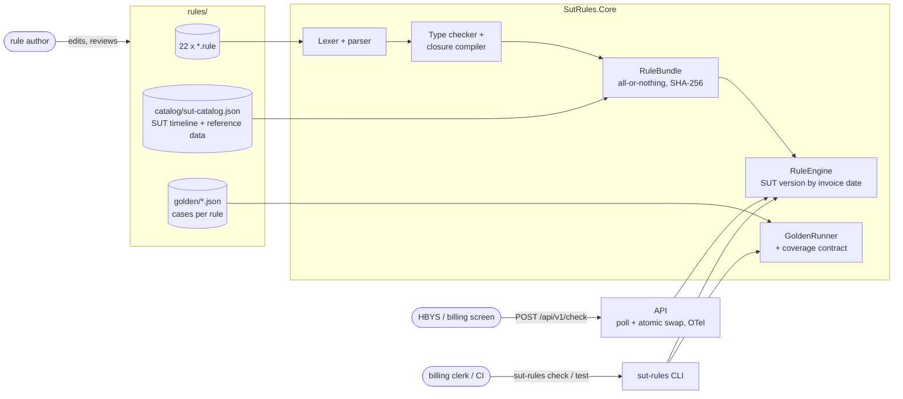

# sut-rules

[](https://github.com/hekimcan206/sut-rules/actions/workflows/ci.yml)
[](https://github.com/hekimcan206/sut-rules/actions/workflows/codeql.yml)

[](LICENSE)

A **versioned rule language for SUT invoice checks**. Each rule lives in its own file, says which SUT versions it
applies to and with what severity and parameters, and is checked against the **SUT version valid on the invoice
date**. Every rule has golden test cases next to it. The 22 rules of
[medula-precheck](https://github.com/hekimcan206/medula-precheck), rewritten as rule files, reproduce its output
**byte for byte on 2,000 invoices**, so it is built to be the engine that project can adopt.

> **Illustrative rules, synthetic data.** The rules follow the *public structure* of the SUT (sex and age limits,
> indications, frequency limits, packages, combined-billing bans, specialty requirements). Codes (`9xxxxx`), prices,
> limits and branch codes are invented. This is **not** the official SUT and must not be used for real billing.
> **All data is synthetic; there is no real personal or health data in this repository.**

## Problem

In Türkiye, hospitals bill the Social Security Institution (**SGK**) through **MEDULA**. What SGK pays is defined
by the **SUT** (*Sağlık Uygulama Tebliği*, Health Implementation Communiqué) and its annex lists, and the SUT is
amended several times a year: 2025 alone saw amendments in January, March, June, December and on 31 December, some
with provisions taking effect on different dates. A pre-check that catches rejections before submission is only
right if it applies the rules **that were in force for that invoice**.

medula-precheck does that with rules written as C# classes and version data in JSON. Every amendment is then a code
change and a release, the history of one rule is spread over C# and JSON, and the people who read amendments
cannot review the rules. Its README lists "a file-based rule DSL" as the next step. This is that step.

## Solution

```text
# ADM-001.rule: introduced as a warning with a 60-day limit in mid-2025; the 2026 amendment cut the limit to 45.
rule "ADM-001" {
  category administrative
  title tr "Fatura geç düzenlenmiş"
        en "Invoice issued late"
  basis "Monthly invoicing deadlines"

  param max_lag_days int

  version "SUT-2025.07" { severity warning max_lag_days = 60 }
  version "SUT-2026.01" { max_lag_days = 45 }

  check invoice {
    require count(lines) > 0
    let lag = invoice.date - max(l in lines: l.date)
    when lag > max_lag_days
      report expected max_lag_days actual lag
  }

  reason tr "Fatura, son hizmetten {actual} gün sonra düzenlenmiş; sınır {expected} gün."
         en "The invoice was issued {actual} days after the last service; the limit is {expected} days."
  fix ChangeInvoiceDate
    tr "Dönem faturasına zamanında ekleyin; gecikme gerekçesini fatura ekinde belirtin."
    en "Include it in the period invoice on time; state the reason for the delay in the invoice annex."
}
```

- **Rules as versioned files** ([ADR 0001](docs/adr/0001-rules-as-versioned-files.md)). Version blocks name SUT
  versions from the catalog; each applies until the next, unset fields inherit, `retired` takes a rule out of force.
  The catalog keeps the timeline and the reference data (prices, limits, indications) as deltas per amendment.
- **A small, typed, total language** ([ADR 0002](docs/adr/0002-language-semantics.md),
  [reference](docs/language.md)). Checked against a schema when the bundle loads: `line.cod` is an error with
  "Did you mean 'code'?", not a surprise on the first matching invoice. No recursion or unbounded loops; regular
  expressions run in linear time. Nulls behave like C#'s lifted operators, which is why the port is exact.
- **Compiled to closures** ([ADR 0003](docs/adr/0003-closure-compilation.md)). The type checker emits delegates with
  names resolved to slots and getters. 22 rules compile in about 3 ms.
- **Golden cases per rule, parity with medula-precheck** ([ADR 0004](docs/adr/0004-golden-cases-and-parity.md)).
  `rules/golden/<ID>.json` holds RFC 7386 merge patches over a base invoice and the exact findings expected. The
  build fails when a rule, or any of its version blocks, has no case where it fires.
- **Hot reload, all or nothing** ([ADR 0005](docs/adr/0005-hot-reload.md)). The API polls the rule directory and swaps
  in a new bundle only if every file compiles; a broken edit leaves the last good bundle serving and shows why.
  Every report names the SHA-256 of the bundle that produced it.

## Architecture



Resolving one invoice:

```mermaid
sequenceDiagram
    participant C as Caller
    participant E as RuleEngine
    participant K as Catalog
    participant R as Compiled rule
    C->>E: Check(invoice)
    E->>K: ResolveFor(invoice.date)
    K-->>E: SUT-2026.01 (or none -> SYS-001, rejected)
    loop each rule in id order
        E->>R: StateFor(SUT-2026.01)
        R-->>E: severity, parameters, block (or not in force)
        E->>R: run checks: let / require / when ... report
    end
    E-->>C: findings ordered by line, rule; outcome; amount at risk
```

## Why this design

- **One file per rule, versions inside it.** An amendment becomes a diff a reviewer can read: the rule, its version
  history and its golden cases sit next to each other. Copying the whole rule set per version would make diffs noise;
  a general rules engine (Drools, DMN) has no notion of "the rule set valid on this date".
- **Parity before features.** Rewriting working rules in a new language is only safe if the old and new outputs are
  compared mechanically. The parity test compares every invoice result as JSON text, including texts and decimal
  scale; an earlier version that compared JSON values let `120.0` pass for `120.00` and was tightened.
- **The language says no.** No user functions, no shadowing, no loops beyond comprehensions, no regex constructs that
  can backtrack. Each restriction removes a way for a rule edit to hang the engine or mean something other than it
  reads.
- **Fail closed.** A broken bundle is never partly loaded, an invoice dated before every SUT version is rejected
  rather than passed, and a run-time error names the rule and invoice instead of returning a partial report.

## Quick start

```bash
docker compose up --build -d     # the API with ./rules mounted; edits are picked up within 2 s
curl -s -X POST localhost:18422/api/v1/check -H 'content-type: application/json' --data-binary @docs/samples/invoices.json
curl -s 'localhost:18422/api/v1/rules?date=2026-03-01'   # which rules apply on a date, severity, parameters
curl -s localhost:18422/api/v1/ruleset                   # bundle hash, SUT timeline, last rejected reload
# API docs: http://localhost:18422/scalar
```

Without Docker, the CLI needs the .NET 10 SDK:

```text
$ dotnet run --project src/SutRules.Cli -- lint
22 rules compiled in 224.9 ms against 3 SUT versions; bundle a98c0eddd3df858ecb4425f82f983aae92922acb5516ec91d76b7552054a3442

$ dotnet run --project src/SutRules.Cli -- test
ok   ADM-001  6/6 cases
...
108/108 golden cases passed, 0 coverage problem(s)

$ dotnet run --project src/SutRules.Cli -- explain --date 2026-03-01
2026-03-01 -> SUT-2026.01 (in force from 2026-01-01): Annual amendment: examination fee update, mammography screening age raised, ECG absorbed into stress test.
  ADM-001  Warning  since SUT-2026.01  Invoice issued late max_lag_days=45
  ...
  PRV-001  Error    since SUT-2026.01  Accident provision without an external-cause code

$ dotnet run --project src/SutRules.Cli -- check --input docs/samples/invoices.json --format markdown --out report.md
checked 40 invoices in 26.6 ms with bundle a98c0eddd3df: 26 clean, 0 need review, 14 would be rejected; 43,765.80 of 298,373.90 TRY at risk
$ echo $?
2        # 2 = at least one invoice would be rejected (usable as a pipeline gate)
```

A broken edit, as the compiler reports it (from the approved diagnostics in
[`tests/.../broken`](tests/SutRules.Tests/Language/broken)):

```text
unknown-names.rule:7:13: error SR103: Unknown function 'procedur'. Did you mean 'procedure'?
unknown-names.rule:8:14: error SR101: 'line' has no field 'cod'. Did you mean 'code'? Fields: no, code, date, quantity, unit_price, amount, doctor.
version-errors.rule:7:3: error SR205: Version blocks must be in ascending SUT order; 'SUT-2025.01' comes after a later or equal version.
```

Sample input and reports: [`docs/samples`](docs/samples) ([Markdown](docs/samples/report.md),
[JSON](docs/samples/report.json), [input](docs/samples/invoices.json)).

Tests: `dotnet test` (no Docker needed; 185 tests).

## Results (measured)

| What | Result |
|---|---|
| Rules | 22 rule files (19–29 lines each), 8 categories, 3 SUT versions; 3 rules have amendment-specific version blocks (ADM-001 introduced then tightened, PKG-004 introduced, PRV-001 warning to error); price, limit and code changes come from the catalog |
| Parity with medula-precheck v1.0.0 | **2,000 / 2,000 invoice results identical as JSON text** (outcomes, amounts, every finding's fields and bilingual texts); the fixture fires all 22 rules |
| Golden cases | 108 hand-written cases; every rule has firing and clean cases, and every version block has a firing case (enforced) |
| Throughput, one core | **115,969 invoices/s** median (20,000-invoice batch) vs **209,327** for medula-precheck's hand-written C# on the same file, same method, interleaved: the rule language costs about 45% |
| Throughput, parallel | 326,847 invoices/s median (PLINQ, 16 logical CPUs, loaded host) |
| Allocation | 4,367 B per invoice (hand-written: 4,231 B); down from 6,334 B after removing per-evaluation closures |
| Compile / reload | 22 rules + catalog in 2.4–3.3 ms warm; load from disk with hashing 4.2–4.9 ms; first compile in a process ~100–120 ms (JIT) |
| Tests | 185 passing: 108 golden cases + 3 golden-runner tests, 2 parity, 8 diagnostics approvals, 32 language semantics, 14 bundle/versioning, 7 FsCheck property tests (up to 2,000 generated invoices or expressions each), 11 API incl. end-to-end hot reload |

Environment (i7-13620H laptop, Windows 11, .NET 10.0.12, other containers running; CPU load 31–37% before the
runs), raw output, method and what was not measured: [docs/benchmarks.md](docs/benchmarks.md).

## Limitations and next steps

- **Not the official SUT.** Codes, prices, limits and texts are invented; real rule families such as medical supplies
  (EK-3) barcode matching, health-board reports, drug rules, co-payment and facility-level restrictions are absent.
- **Version by invoice date**, like medula-precheck. Real tariffs apply by service date and a provision can span an
  amendment; per-line resolution would change the lookup key, not the model.
- **No formatter.** The canonical printer exists and is property-tested (print then parse gives the same tree), but
  comments are not part of the syntax tree, so it is not offered as a `fmt` command that would delete them.
- **Speed.** About 55% of hand-written C#. Typed delegates or an expression-tree backend could close the gap behind
  the same type checker; the parity and golden suites would gate it. Rules that compare each line with every other
  line are quadratic, which is fine at 2.7 lines per invoice and untested on long inpatient invoices.
- **Language limits.** No user-defined functions or modules: shared logic is repeated with `let`. Two-valued
  conditions (`not (x > 5)` is true when `x` is null) follow C#, not SQL.
- **No PL/SQL path.** medula-precheck also runs 13 rules set-based inside Oracle; generating PL/SQL from rule files
  is a natural follow-up but not done.
- **No authentication or rate limiting** in the API: it is meant to run behind the HBYS gateway. Reloading is per
  instance; several instances converge within one poll interval.

## Privacy (KVKK)

Health data is special-category personal data under KVKK (Law No. 6698). Here:

- all data is **synthetic** (medula-precheck's Bogus generator with the Turkish locale, or hand-written cases);
- the model carries only what rules need: birth date, sex, diagnoses and services. A patient is an opaque token;
  there is no name or national-id field, and unknown input fields (such as a name) are ignored and never echoed;
- reports contain invoice numbers and codes, never patient identity; request logs never contain bodies;
- the service stores nothing.

See [docs/threat-model.md](docs/threat-model.md).

## Public sources consulted

Structure only, no content copied: SUT amendments published in the Resmi Gazete in 2025 (for example 26 June 2025);
SGK's MEDULA provider flow; RFC 7386 (JSON Merge Patch); the DMN FEEL / B-FEEL null-semantics discussion; PostgreSQL's
GREATEST/LEAST documentation; .NET regular-expression guidance on non-backtracking mode. Links are in the ADRs.

## License

[MIT](LICENSE)
